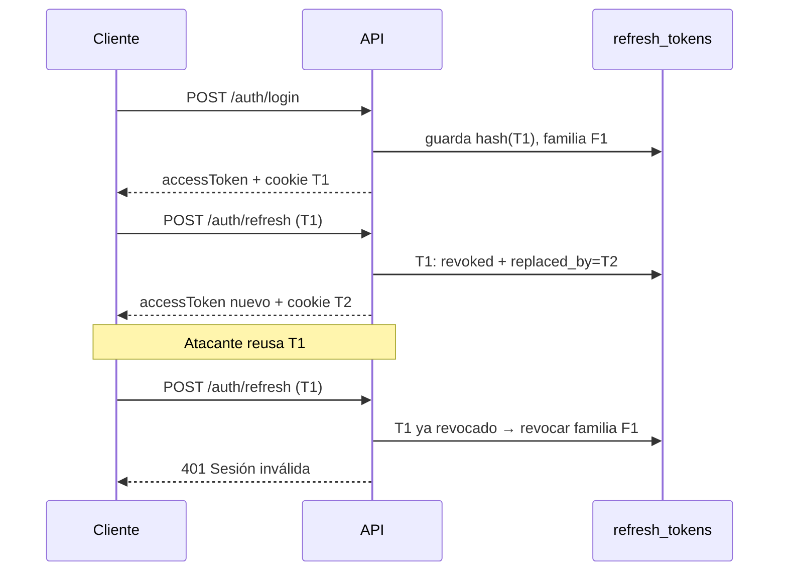

# Autenticación JWT - US-007

Sistema de autenticación con **access token JWT de corta vida** y **refresh token
opaco rotativo persistido en BD**, según los criterios de US-007 y el diseño de
arquitectura §8.2. US-008 agregó los permisos granulares (`requirePermission`) y
TASK-08, la revocación inmediata de access tokens.

## 1. Diseño general

| | Access token | Refresh token |
| --- | --- | --- |
| Formato | JWT firmado (HS256) | Opaco: 256 bits aleatorios |
| Vida útil | 15 min (`JWT_ACCESS_EXPIRES`) | 7 días (`JWT_REFRESH_EXPIRES`) |
| Persistencia | Ninguna: el token no tiene fila propia | Tabla `refresh_tokens` (hash sha256) |
| Viaja en | Header `Authorization: Bearer` | Cookie httpOnly `refresh_token` |
| Revocable | Por usuario: todos los emitidos antes de `users.tokens_revoked_at` (§5) | Sí, en cualquier momento (server-side) |

**Decisión de diseño:** el refresh token NO es un JWT. Su validez no vive en una
firma sino en su fila de la BD (`revoked_at`, `replaced_by`, `expires_at`), lo
que permite revocación server-side inmediata: logout real, cierre forzoso de
sesiones al cesar un empleado y detección de robo. Un refresh JWT stateless no
podría invalidarse antes de su expiración.

El access token tampoco depende solo de su firma: en cada petición `authenticate`
lee el estado del usuario (§5). Así, un cierre forzoso de sesiones o una
desactivación cortan también los access tokens vivos, sin esperar a su `exp`.

## 2. Payload del access token

```json
{
  "sub": "876cfc6c-...",          // user_id
  "email": "usuario@empresa.com",
  "permissions": ["colaborador:leer", "contrato:crear", "..."],
  "iat": 1754850000,               // emisión, en segundos: se compara con tokens_revoked_at
  "exp": 1754850900                // iat + 900s
}
```

Los permisos se resuelven en el login/refresh desde las tablas RBAC
(`user_roles → role_permissions → permissions`) y los consume el middleware
`requirePermission` (US-008). Un cambio de permisos se refleja en el siguiente
login o refresh (máximo 15 minutos); para aplicarlo de inmediato, cerrar las
sesiones del usuario con `DELETE /api/users/:id/sessions`.

## 3. Rotación y familias de tokens

Cada login crea una **familia** (`token_family_id`) — una familia = una sesión
en un dispositivo. Cada `POST /auth/refresh`:

1. Emite un token nuevo **de la misma familia**.
2. Marca el anterior: `revoked_at = now()`, `replaced_by = <id del nuevo>`.

**Detección de reuso (robo):** si llega un refresh token ya revocado o ya
reemplazado, se asume compromiso y se revoca **la familia completa** → el
atacante y la víctima pierden la sesión → 401 y re-login.



## 4. Endpoints

### POST /api/auth/login

```json
// Request
{ "email": "usuario@empresa.com", "password": "********" }

// Response 200
{
  "success": true,
  "message": "Success",
  "data": { "accessToken": "eyJ...", "expiresIn": 900 }
}
```

Además setea la cookie del refresh token:
`refresh_token=<token>; Path=/api/auth; HttpOnly; SameSite=Strict; Max-Age=604800`
(+ `Secure` en producción).

| Error | HTTP | Detalle |
| --- | --- | --- |
| Credenciales inválidas | 401 | Mismo mensaje y mismo tiempo de respuesta si el email no existe (anti-enumeración, ver abajo) |
| Cuenta bloqueada | 429 | 5 intentos fallidos → bloqueo 15 min (exponencial: 15/30/60… máx 24 h). Incluye `retryAfterSeconds` |
| Cuenta inactiva | 403 | Usuario desactivado. Solo se informa si la contraseña es correcta |
| Body inválido | 422 | Validación Zod |

**Tiempo constante ante un email inexistente:** verificar una contraseña cuesta
un bcrypt de costo 12 (unos 300 ms); sin él, un email inexistente respondería en
pocos milisegundos y el tiempo revelaría qué emails existen. Por eso, cuando el
email no existe, `BcryptPasswordHasher.simulateVerify()` compara contra
`DUMMY_HASH`, un hash ficticio con el mismo costo que `SALT_ROUNDS`. Si se
cambia `SALT_ROUNDS`, hay que regenerar `DUMMY_HASH` con el costo nuevo.

### POST /api/auth/refresh

Lee la cookie `refresh_token` (no requiere Bearer). Devuelve el mismo shape que
login y rota la cookie. 401 si el token no existe, está revocado, expiró o el
usuario ya no está activo (en ese último caso también revoca la familia).

### POST /api/auth/logout

Revoca la **familia completa** del refresh token de la cookie y la limpia.
Idempotente: responde 200 aunque no haya sesión. No invalida el access token de
ese dispositivo (ver §8).

### DELETE /api/users/:id/sessions

Requiere `Authorization: Bearer <accessToken>` y el permiso `usuario:gestionar`.
Cierra **todas** las sesiones del usuario `:id`, en dos escrituras:

1. `users.tokens_revoked_at = now()`: los access tokens emitidos antes dejan de
   valer en su siguiente petición (§5).
2. Revoca todos sus refresh tokens: ningún dispositivo puede renovar la sesión.

El orden es intencional: si la segunda escritura falla, los access tokens ya
quedaron cortados, y reintentar la petición completa la revocación.

Si un admin cierra sus propias sesiones, su token actual también deja de valer.

```json
// Response 200
{ "success": true, "message": "Success", "data": { "revokedCount": 4 } }
```

| Error | HTTP |
| --- | --- |
| Sin bearer token o token rechazado | 401 (§5) |
| Sin el permiso `usuario:gestionar` | 403 (`No tienes permisos para gestionar usuarios`) |
| `:id` no es un UUID | 422 |
| Usuario inexistente | 404 |

**Regla de persistencia:** `tokens_revoked_at` se escribe con un `UPDATE` de esa
sola columna (`IUserRepository.markTokensRevoked`) y no pasa por la entidad
`User` ni por `UserMapper.toPersistence`. El login lee al usuario, espera el
bcrypt y luego hace `save(user)`: si la columna pasara por el mapper, ese
`save` sobrescribiría una revocación hecha en ese intervalo con el valor leído
antes.

## 5. Middleware `authenticate`

`src/modules/auth/presentation/middlewares/authenticate.middleware.ts` extrae el
Bearer token y delega en `VerifyAccessUseCase`
(`src/modules/auth/application/verify-access.use-case.ts`):

1. Verifica la firma y la expiración del JWT (`ITokenSigner.verifyAccess`).
2. Lee por clave primaria `is_active` y `tokens_revoked_at` del usuario
   (`IUserRepository.findAccessStatus`, que ignora usuarios con `deleted_at`).
3. Rechaza el token si el usuario no existe, está eliminado o desactivado, o si
   el token se emitió antes de `tokens_revoked_at`.

Si pasa, expone la identidad al resto de la app:

```ts
req.auth = { userId, email, permissions };
```

| Motivo del 401 | Error |
| --- | --- |
| Falta el header o no es `Bearer <token>` | `UnauthorizedError` (`Token de acceso requerido`) |
| Token expirado | `AccessTokenExpiredError` |
| Firma inválida o token malformado | `InvalidAccessTokenError` |
| Usuario inexistente, eliminado o desactivado | `AccessRevokedError` (`La sesión fue cerrada. Inicia sesión nuevamente`) |
| Token emitido antes de `tokens_revoked_at` | `AccessRevokedError` |

Un usuario desactivado recibe aquí 401 y no el 403 del login: para el cliente el
token ya no sirve y debe volver a iniciar sesión, donde verá el 403.

**Precisión de la comparación:** `iat` está en segundos enteros y
`tokens_revoked_at` en milisegundos. Se rechaza el token si
`iat * 1000 < tokens_revoked_at`. Un login hecho en el mismo segundo de la
revocación, aunque sea después de ella, también se rechaza; el usuario solo
tiene que iniciar sesión otra vez. Es el redondeo del lado seguro.

**Costo:** cada petición autenticada hace una lectura por clave primaria de dos
columnas en `users`.

## 6. Variables de entorno

| Variable | Ejemplo | Notas |
| --- | --- | --- |
| `JWT_ACCESS_SECRET` | (secreto ≥ 32 chars) | Firma HS256 del access token |
| `JWT_REFRESH_SECRET` | (secreto ≥ 32 chars, distinto del anterior) | `env.ts` la exige, pero hoy no se usa: el refresh token es opaco (§1) |
| `JWT_ACCESS_EXPIRES` | `15m` | Acepta `s/m/h/d`; default 15m |
| `JWT_REFRESH_EXPIRES` | `7d` | Vida del refresh token y de su cookie |

## 7. Tests

```bash
pnpm test        # unitarios (src/**/*.test.ts)
pnpm test:e2e    # Supertest contra la BD de tests
```

| Archivo e2e | Cubre |
| --- | --- |
| `tests/e2e/auth.e2e.test.ts` | US-007: login, refresh con rotación y reuso, logout, `DELETE` sin token o sin permiso |
| `tests/e2e/rbac.e2e.test.ts` | US-008: permisos en el token y `requirePermission` |
| `tests/e2e/auth-revocation.e2e.test.ts` | TASK-08: tiempo de login con email inexistente, revocación inmediata, usuario desactivado o eliminado |

Los e2e usan `TEST_DATABASE_URL` del `.env`, que debe apuntar a una base cuyo
nombre termine en `_test`; sin la variable usan `localhost:5433/kontrak_test`.
`global-setup.ts` aplica las migraciones y el seed antes de correrlos.

## 8. Limitaciones conocidas

- **Logout no corta el access token.** Revoca solo la familia del dispositivo;
  su access token sigue valiendo hasta su `exp` (máximo 15 min). No se usa
  `tokens_revoked_at` porque cerraría las sesiones de todos los dispositivos
  del usuario.
- **Cambios de permisos:** llegan en el siguiente login o refresh (máximo
  15 min), salvo que se cierren las sesiones del usuario (§2).
- **Ventana de menos de 1 s** tras una revocación, en la que un login nuevo
  también se rechaza (§5).
